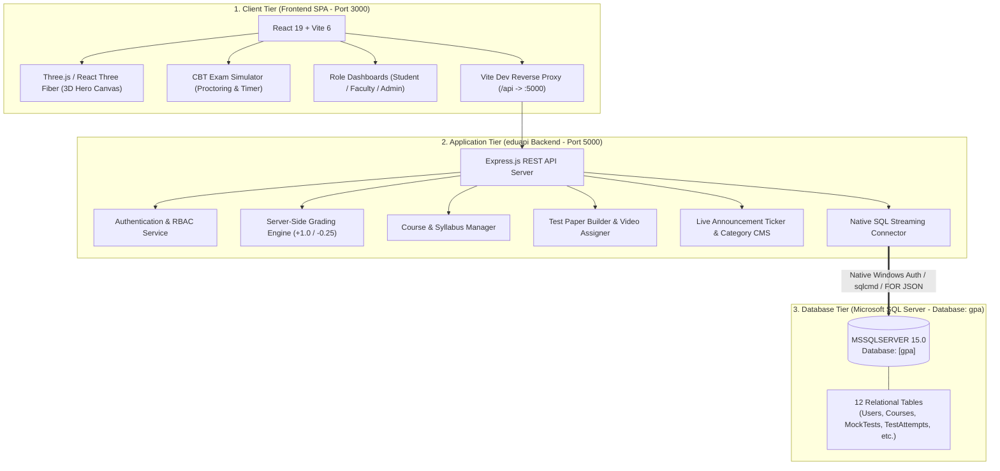
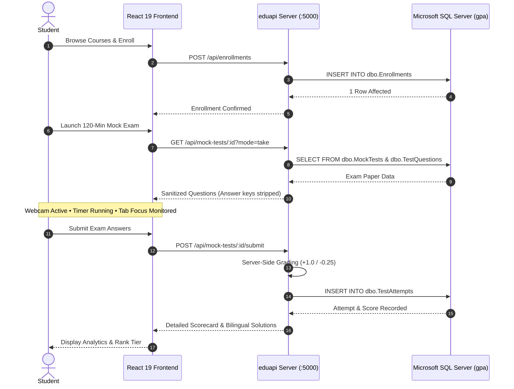

# 🎓 Gyan Prapti Academy (GPA) — Executive Project Presentation Summary

> **A Complete Full-Stack EdTech Web Platform for Competitive Exam Aspirants (Banking, SSC, Railways & UPSC CSAT)**

---

## 1. 📌 Project Overview (Elevator Pitch)

**Gyan Prapti Academy (GPA)** is an end-to-end EdTech platform built for students preparing for India's premier government exams (Banking SBI/IBPS PO, SSC CGL/CHSL, Railways RRB NTPC, and UPSC CSAT Paper 2).

It bridges modern web experiences with high-stakes exam preparation by offering:
- Structured video courses with playlist lessons.
- **TCS iON / Testbook-Grade** 120-minute proctored CBT (Computer-Based Test) exam halls.
- An intelligent anti-cheating engine with live webcam monitoring.
- A proprietary **Talent Index (0–100)** performance algorithm.
- Dedicated role-based portals for **Students**, **Teachers**, and **Administrators**.

---

## 2. 🏛️ 3-Tier System Architecture

---

## 3. 🛠️ Complete Technology Stack

| Layer | Technologies Used | Description |
| :--- | :--- | :--- |
| **Frontend Framework** | **Vite 6 + React 19** | Ultra-fast SPA with instant HMR and minimal bundle footprint. |
| **Routing** | **React Router DOM v7** | Client-side routing with role-protected dashboard guards. |
| **Styling & Design** | **Tailwind CSS v4** | Modern utility-first styling with dynamic CSS variables & dark mode. |
| **3D Graphics** | **Three.js + React Three Fiber** | Interactive 3D particle constellation and academic emblem physics. |
| **Animations** | **Framer Motion** | Micro-interactions, page transitions, and accordion animations. |
| **Backend Framework**| **Node.js + Express.js** | Modular REST API service (`eduapi`) running on port 5000. |
| **Database Engine** | **Microsoft SQL Server (2019)** | Local enterprise database named `gpa` with 12 normalized tables. |
| **Database Sync** | **Native SQL JSON Streaming** | Executes parameterized queries with `FOR JSON PATH` streaming. |

---

## 4. 🌟 Top 5 Standout Features (Presentation USPs)

### 1. 🛡️ Proctored CBT Exam Hall Simulator
- **120-Minute Real Exam Hall**: Timer, sectional navigation (Quant, Reasoning, English, General Awareness), question status palette (*Answered*, *Marked for Review*, *Not Visited*).
- **Live Webcam Monitoring**: Direct browser media stream (`getUserMedia`) self-preview.
- **Anti-Cheating Intelligence**: Tab blur / switch detection and fullscreen exit warnings; automated test termination after 3 warnings.
- **Server-Side Secure Evaluation**: Prevents inspect-element cheating; grades with standard competitive negative marking (**+1.0 correct**, **-0.25 wrong penalty**) and returns bilingual explanations (English & Hindi).

### 2. 🌌 Interactive 3D Hero Scene
- Three.js / React Three Fiber renders academic geometry and floating celestial particles in the hero section that respond dynamically to mouse movement.

### 3. 📊 Proprietary Talent Index Algorithm
- Computes an aggregate **0 to 100 readiness score** for aspirants:
  $$\text{Talent Index} = \text{Tests (40)} + \text{Courses (25)} + \text{Resources (10)} + \text{Streak (15)} + \text{Profile (10)}$$
- Assigns students into competitive tiers: **Beginner**, **Bronze**, **Silver**, and **Gold**.

### 4. 👥 3 Distinct Role-Based Portals (RBAC)
- **Student Portal**: Performance charts, past scorecards, daily login streaks, course progress, formula PDFs.
- **Teacher Portal**:
  - *Paper Builder*: Form for faculty to author questions with bilingual options, marks, and explanations.
  - *Video Assigner*: Assign YouTube playlists and lectures to targeted student batches.
- **Admin Portal**: User roster management, account suspensions (ban with reason), and real-time Homepage CMS (announcement marquee and category cards).

### 5. 🗄️ Enterprise Microsoft SQL Server Integration (`gpa`)
- Connected to local Microsoft SQL Server (`MSSQLSERVER`) with 12 relational tables:
  1. `dbo.Users` — Student, faculty, and administrator profiles.
  2. `dbo.Courses` — Course catalog, pricing in paise, ratings, and syllabus.
  3. `dbo.CourseVideos` — Lecture modules, video durations, and YouTube links.
  4. `dbo.Enrollments` — Student enrollment links and completion progress.
  5. `dbo.MockTests` — 120-minute CBT exam papers and passing criteria.
  6. `dbo.TestQuestions` — Question bank with bilingual questions, options, and keys.
  7. `dbo.TestAttempts` — Exam scorecards, time spent, and anti-cheating violation records.
  8. `dbo.TeacherVideos` — Batch-targeted faculty masterclasses.
  9. `dbo.Notes` — Downloadable revision notes and formula books.
  10. `dbo.MarqueeItems` — Live homepage breaking news ticker items.
  11. `dbo.ExamCategories` — Homepage category navigation cards.
  12. `dbo.ContactMessages` — Student admissions counseling inquiries.

---

## 5. 🔄 End-to-End User Flow

---

## 6. 🗣️ Presentation Speaking Notes (1-Minute Pitch)

> *"Gyan Prapti Academy (GPA) is a full-stack, enterprise-grade EdTech platform designed specifically for competitive exam aspirants (Banking, SSC, Railways, and UPSC CSAT).*
>
> *On the frontend, we use React 19 with Vite, Tailwind CSS v4, and Three.js for interactive 3D hero physics. On the backend, we engineered a dedicated Express.js REST API service called `eduapi`.*
>
> *The entire application is wired directly to a local Microsoft SQL Server database named `gpa` with 12 normalized relational tables, featuring real-time persistence and native JSON streaming.*
>
> *Our biggest technical highlight is the proctored CBT Exam Simulator — featuring live webcam streaming, browser tab-switch detection, and server-side grading with negative marking to prevent exam tampering. In addition, the platform features a custom Talent Index algorithm to track student readiness and dedicated portals for Students, Faculty, and Administrators."*

---

*Authored for: Gyan Prapti Academy (GPA) Architecture & Project Review*
